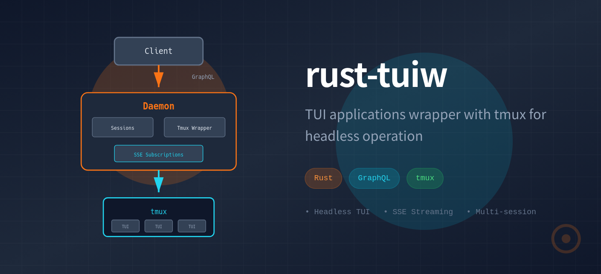

# tuiw

[](https://crates.io/crates/tuiw)
[](https://docs.rs/tuiw)
[](https://github.com/conao3/rust-tuiw/blob/master/LICENSE)



TUI applications wrapper with tmux for headless operation.

## Overview

rust-tuiw is a simple CLI wrapper around tmux that enables headless interaction with TUI (Terminal User Interface) applications. It provides an easy-to-use interface for programmatic control and automation of interactive terminal applications.

## Getting Started

### Prerequisites

- Rust toolchain (1.91.1 or later)
- tmux
- NixOS users: Use `nix develop` for development environment

### Installation

Install via crates.io.

```bash
cargo install tuiw
```

or install via nixpkgs.

```bash
nix shell github:conao3/rust-tuiw
```

or install from source.

```bash
git clone https://github.com/conao3/rust-tuiw.git
cd rust-tuiw
cargo build --release
./target/release/tuiw --help
```

### Basic Usage

tuiw takes arguments in the AWS CLI grammar: `tuiw [global options] session <subcommand> [--parameter value ...]`. Every parameter is named (`--kebab-case`), booleans come in `--flag` / `--no-flag` pairs, and a value starting with `file://` is read from that file (`file:///dev/stdin` reads stdin).

#### 1. Create a Session

Create a new TUI session by specifying the command to run:

```bash
tuiw session create-session --command bash
```

This prints the session ID (8 character hex format):

```json
{
  "SessionId": "2a638ef5"
}
```

You can also specify a working directory, and take the ID alone with `--query` and `--output text`:

```bash
tuiw session create-session --command vim --cwd /path/to/project --query SessionId --output text
```

#### 2. List Sessions

View all active tuiw sessions:

```bash
tuiw session list-sessions
tuiw session list-sessions --query Sessions --output table
```

Each entry of `Sessions` has `SessionId`, `Command` and `Cwd`.

#### 3. Send Keys

Send keyboard input to a session. `--keys` takes one or more values that are passed to `tmux send-keys` in order. By default, Enter is sent after the keys:

```bash
tuiw session send-keys --session-id 2a638ef5 --keys "echo hello"
```

To send keys without Enter, use `--no-newline`:

```bash
tuiw session send-keys --session-id 2a638ef5 --keys i --no-newline
tuiw session send-keys --session-id 2a638ef5 --keys Escape --no-newline
```

#### 4. View Screen

Capture the current screen content with colors (default). The screen is in `Screen`:

```bash
tuiw session get-screen --session-id 2a638ef5 --query Screen --output text
```

To capture without colors, use `--no-color`:

```bash
tuiw session get-screen --session-id 2a638ef5 --no-color --query Screen --output text
```

#### 5. Close Session

Terminate a session:

```bash
tuiw session delete-session --session-id 2a638ef5
```

#### Common options

- `--output json|text|table` (default `json`) and `--query <JMESPath>` shape the output. Output keys are PascalCase.
- `--cli-input-json '{"SessionId": "2a638ef5", "Keys": ["ls"]}'` passes the parameters as JSON (parameters given on the command line win). `--generate-cli-skeleton input|output` prints the input or output skeleton.
- `help` works at every level: `tuiw help`, `tuiw session help`, `tuiw session send-keys help`. `--debug` prints the parsed parameters to stderr. `--version` prints the version.
- Exit codes: 0 on success, 252 for a syntax or parameter error, 254 when tmux or the target fails (session not found, missing working directory, tmux error), 255 for other failures.

### Example: Automating vim

```bash
# Create a vim session
SESSION_ID=$(tuiw session create-session --command vim --query SessionId --output text)

# Open a file
tuiw session send-keys --session-id "$SESSION_ID" --keys ":e test.txt"

# Enter insert mode and type
tuiw session send-keys --session-id "$SESSION_ID" --keys i --no-newline
tuiw session send-keys --session-id "$SESSION_ID" --keys "Hello, World!"

# Save and quit
tuiw session send-keys --session-id "$SESSION_ID" --keys Escape --no-newline
tuiw session send-keys --session-id "$SESSION_ID" --keys ":wq"

# Close session
tuiw session delete-session --session-id "$SESSION_ID"
```

### Troubleshooting

**Session not found:**
- Verify the session ID is correct using `tuiw session list-sessions`
- Check if the tmux session still exists with `tmux list-sessions`

**Keys not being sent:**
- By default, Enter is sent after the keys. Use `--no-newline` to suppress it
- Special keys like Escape should be sent with `--no-newline`

**tmux not found:**
- Ensure tmux is installed and in PATH
- On NixOS, use `nix develop` or run with `steam-run tuiw`

## Architecture

tuiw is a simple CLI wrapper around tmux. Each tuiw session corresponds to a tmux session with the name pattern `tuiw-{session_id}`.

### How it works

```
┌─────────────────────────────────────┐
│         tuiw CLI                    │
│  (Command line interface)           │
└──────────────┬──────────────────────┘
               │
               │ Direct tmux commands
               │
┌──────────────▼──────────────────────┐
│        tmux Sessions                │
│   ┌──────────────────────┐          │
│   │  tuiw-2a638ef5       │          │
│   │  ┌────────────────┐  │          │
│   │  │   TUI App      │  │          │
│   │  │   (e.g., vim)  │  │          │
│   │  └────────────────┘  │          │
│   └──────────────────────┘          │
│   ┌──────────────────────┐          │
│   │  tuiw-f3b91a2c       │          │
│   │  ┌────────────────┐  │          │
│   │  │   TUI App      │  │          │
│   │  │   (e.g., bash) │  │          │
│   │  └────────────────┘  │          │
│   └──────────────────────┘          │
└─────────────────────────────────────┘
```

### Session Management

- Session IDs are 8-character hexadecimal strings (derived from UUID)
- tmux session names follow the pattern `tuiw-{session_id}`
- Session metadata (command, cwd) is stored in `~/.config/tuiw/session.json`
- Stale sessions (where tmux session no longer exists) are automatically cleaned up when running `session create-session` or `session list-sessions`
- Sessions persist until explicitly closed or tmux server is stopped
- Multiple TUI applications can run simultaneously in separate sessions

## Use Cases

### Primary: Claude Code Automation

Claude Code currently lacks a headless interaction mode. By wrapping Claude Code with rust-tuiw, you can:
- Programmatically send commands
- Monitor output changes
- Automate coding workflows

### General TUI Automation

Since rust-tuiw works with any TUI application, it enables automation for:
- All coding agents (not just Claude Code)
- Interactive CLI tools
- Terminal-based development environments
- Any ncurses/TUI application

## Technology Stack

- **Language**: Rust (edition 2024)
- **Async Runtime**: tokio (minimal features)
- **CLI Parsing**: clap (AWS CLI grammar) and jmespath for `--query`
- **Process Management**: tmux

## Development

See `Makefile` for available commands:
- `make build` - Build the project
- `make run` - Run the application
- `make test` - Run tests
- `make check` - Run cargo check
- `make clippy` - Run clippy lints
- `make fmt` - Format code

## License

Apache-2.0
